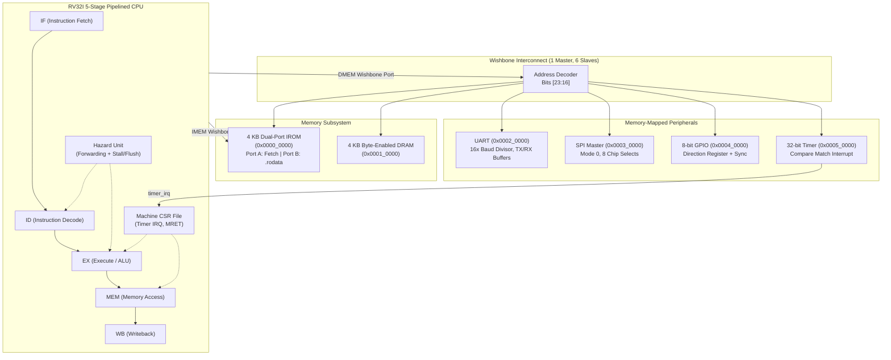

# MiniSoC-32: Open-Source RISC-V (RV32I) System-on-Chip

[]()
[]()
[]()
[-brightgreen.svg)]()
[]()

**MiniSoC-32** is a synthesizable 32-bit RISC-V System-on-Chip designed from RTL architecture to GDSII silicon layout using exclusively open-source EDA tools. The core implements the standard unprivileged RV32I integer instruction set in a classic 5-stage pipeline, connected over a Wishbone B4 interconnect to 4 KB instruction ROM, 4 KB byte-addressable data RAM, and 4 memory-mapped peripherals (UART, SPI Master, GPIO, Timer with interrupt).

---

## Architecture Overview



### Key Technical Specifications
- **CPU Core**: RV32I 5-stage pipeline (`IF`, `ID`, `EX`, `MEM`, `WB`).
- **Hazard Handling**:
  - Full data forwarding (EX-to-EX and MEM-to-EX paths for ALU operations).
  - 1-cycle hardware load-use hazard stall with pipeline bubble insertion.
  - 2-cycle branch and jump flush penalty.
- **CSR & Interrupts**: Minimal machine-mode CSRs (`mstatus`, `mie`, `mip`, `mtvec`, `mepc`, `mcause`), vectored machine-timer interrupt trap handling, and `MRET` instruction.
- **Interconnect**: Wishbone B4 pipelined architecture, byte-enable (`wb_sel[3:0]`) support, with address decoding on `m_wb_adr[23:16]`.
- **Memory**:
  - 4 KB dual-port Instruction ROM (concurrent CPU fetch and `.rodata` Wishbone access).
  - 4 KB byte-addressable Data RAM with independent byte lanes.
- **Peripherals**:
  - UART: Full-duplex, 16× oversampled baud rate generator, status flags (`tx_idle`, `rx_ready`).
  - SPI Master: Mode 0 (CPOL=0, CPHA=0), programmable clock divider, 8 chip-select lines.
  - GPIO: 8-bit bidirectional I/O with data direction register and 2-stage synchronizer flip-flops.
  - Timer: 32-bit up-counter with target compare match, auto-reload, and interrupt assertion to CPU.

---

## Memory Map

| Region | Base Address | End Address | Size | Description |
| :--- | :--- | :--- | :--- | :--- |
| **Instruction ROM** | `0x0000_0000` | `0x0000_0FFF` | 4 KB | Read-only firmware storage (`.text`, `.rodata`) |
| **Data RAM** | `0x0001_0000` | `0x0001_0FFF` | 4 KB | Read/Write data storage (`.data`, `.bss`, stack) |
| **UART Controller** | `0x0002_0000` | `0x0002_00FF` | 256 B | Data TX/RX registers, status, and baud divisor |
| **SPI Master** | `0x0003_0000` | `0x0003_00FF` | 256 B | Control/status, clock divider, chip-select, TX/RX |
| **GPIO Controller** | `0x0004_0000` | `0x0004_00FF` | 256 B | Data input, data output, and direction registers |
| **32-Bit Timer** | `0x0005_0000` | `0x0005_00FF` | 256 B | Counter value, compare match, control, and status |

**Reset Vector:** `0x0000_0000`  
**Stack Pointer Top:** `0x0001_1000` (Top of DRAM)

---

## Repository Structure

```text
minisoc/
├── docs/                      # Comprehensive technical documentation
│   ├── ARCHITECTURE.md        # Hardware specifications and register maps
│   ├── REPORT.md              # Full academic final-year project report
│   ├── RESULTS.md             # Synthesis, physical design, and timing signoff
│   ├── PROGRESS.md            # Engineering development log & bug fix tracker
│   └── VIVA_QA.md             # 30 viva exam questions and detailed answers
├── fw/                        # Bare-metal C & Assembly firmware
│   ├── include/minisoc.h      # Memory-mapped peripheral drivers & CSR macros
│   ├── src/startup.S          # Vector initialization, crt0, stack & trap handler
│   ├── src/main.c             # Multi-peripheral self-test firmware
│   ├── src/demo_*.c           # Individual peripheral demo programs
│   ├── link.ld                # GNU ld linker script (IROM + DRAM sections)
│   └── Makefile               # Firmware compilation and hex generation
├── rtl/                       # Synthesizable SystemVerilog RTL
│   ├── cpu/                   # ALU, Regfile, Control, Imm-Gen, Hazards, CSRs, CPU
│   ├── bus/                   # Wishbone B4 interconnect and address decoder
│   ├── mem/                   # Dual-port IROM and byte-enabled DRAM
│   ├── periph/                # UART, SPI Master, GPIO, and 32-bit Timer
│   └── top/minisoc_top.sv     # System-on-Chip top-level integration
├── tb/                        # Self-checking testbenches
│   ├── unit/cpu/              # CPU module unit testbenches
│   ├── unit/bus/              # Bus decoder testbench
│   ├── unit/mem/              # IROM and DRAM unit testbenches
│   ├── unit/periph/           # UART, SPI, GPIO, and Timer testbenches
│   ├── soc_tb.sv              # Full-system testbench with real-time UART RX
│   └── system/                # System-level RTL and Gate-Level testbenches
├── syn/                       # Yosys synthesis scripts & mapped netlists
├── pd/                        # OpenLane 2 configs, PnR runs, and GDSII layouts
└── scripts/                   # Automated build & regression scripts
    ├── regress.sh             # 13/13 test suite regression script
    ├── prepare_gls.py         # Gate-level simulation netlist prep script
    └── run_all.sh             # End-to-end regression, synthesis & GLS runner
```

---

## Toolchain Prerequisites

Ensure the following open-source tools are installed (Ubuntu / WSL):
- **Simulation**: Icarus Verilog (`iverilog` >= 12.0) or Verilator (>= 5.018)
- **Waveforms**: GTKWave
- **Firmware**: RISC-V GNU Toolchain (`riscv64-unknown-elf-gcc` or `riscv32-unknown-elf-gcc`)
- **Synthesis**: Yosys (>= 0.52)
- **Physical Design**: OpenLane 2 (>= 2.3.10) with SkyWater 130nm (`sky130_fd_sc_hd`) PDK installed in `~/.volare`

---

## Quickstart & Execution

### 1. Build Firmware & Demos
```bash
cd fw
make clean && make all
make demos
```

### 2. Run RTL Testbench Regression (13/13 PASS)
```bash
bash scripts/regress.sh
```

### 3. Run Yosys Logic Synthesis
```bash
yosys -s syn/synth.ys
```

### 4. Run OpenLane 2 Physical Design (RTL-to-GDSII)
```bash
# 33.3 MHz Signoff run (Highest frequency closing across ALL 9 PVT corners)
openlane --dockerized pd/config_30ns.json

# 25 MHz run (Relaxed timing baseline)
openlane --dockerized pd/config_40ns.json

# 50 MHz run (Multi-corner comparison)
openlane --dockerized pd/config_50mhz.json

# 100 MHz run (Failed target / timing exploration)
openlane --dockerized pd/config_100mhz.json
```
*Note: Tapeout GDSII layout files (120 MB each) are excluded from git tracking per GitHub file-size limits. They can be reproduced deterministically by running any of the above OpenLane commands. Key signoff metrics and reports are preserved in `docs/evidence/`.*

### 5. Run Gate-Level Simulation (GLS)
```bash
python3 scripts/prepare_gls.py
iverilog -g2012 -o /tmp/tb_gls.vvp /usr/share/yosys/simlib.v syn/reports/minisoc_top_gls.v tb/system/tb_minisoc_top_gls.sv
vvp /tmp/tb_gls.vvp
```
*RTL and Gate-Level UART execution logs are saved side by side in [`docs/logs/uart_rtl.log`](file:///home/manthan/minisoc/docs/logs/uart_rtl.log) and [`docs/logs/uart_gls.log`](file:///home/manthan/minisoc/docs/logs/uart_gls.log).*

### 6. Run Complete Pipeline (Regression + Synthesis + GLS)
```bash
bash scripts/run_all.sh
```

---

## Physical Design Signoff Summary (SkyWater 130nm)

| Metric | 33.3 MHz (Highest All Corners) | 25 MHz (Signoff Baseline) | 50 MHz (Multi-Corner Failure) | 100 MHz (Failed Target) | Signoff Notes |
| :--- | :--- | :--- | :--- | :--- | :--- |
| **Clock Period ($T_{clk}$)** | **30.00 ns** | **40.00 ns** | **20.00 ns** | **10.00 ns** | 33.3 MHz is highest closing target ✅ |
| **Overall Setup WNS (Worst All Corners)** | **0.0000 ns** | **0.0000 ns** | **-2.7145 ns** | **-12.0448 ns** | WNS = worst slack across ALL corners |
| **Worst Setup Slack ($WS$)** | **+1.1600 ns** (Met ✅) | **+9.5689 ns** (Met ✅) | **-2.7145 ns** (Violated ⚠️) | **-12.0448 ns** (Violated ⚠️) | At extreme slow `max_ss_100C_1v60` |
| **Overall Hold WNS** | **0.0000 ns** (Met ✅) | **0.0000 ns** (Met ✅) | **0.0000 ns** (Met ✅) | **-0.4350 ns** (Violated ⚠️) | 100 MHz suffers hold violation ⚠️ |
| **Worst Hold Slack ($WS$)** | **+0.1017 ns** (Met ✅) | **+0.1087 ns** (Met ✅) | **+0.1091 ns** (Met ✅) | **-0.4350 ns** (Violated ⚠️) | Clean hold margin at 33/25/50 MHz |
| **Nominal Setup Slack (`nom_tt_025C_1v80`)** | **+16.3235 ns** | **+25.3838 ns** | **+8.3836 ns** | **-1.2406 ns** | 50 MHz meets nominal only |
| **Worst-Case Path Delay ($T_{crit,worst}$)** | **28.8400 ns** | **30.4311 ns** | **22.7145 ns** | **22.0448 ns** | At `max_ss_100C_1v60` (100°C, 1.6V) |
| **Estimated Total Power (Nominal)** | **31.64 mW** | **23.74 mW** | **40.35 mW** | **81.15 mW** | OpenROAD STA activity estimate |
| **Estimated Total Power (Worst Corner)** | **31.64 mW** | **23.74 mW** | **47.53 mW** | **95.56 mW** | OpenROAD STA activity estimate |
| **Die Dimensions / Total Area** | 1086.73 × 1097.45 µm | 1086.73 × 1097.45 µm | 1086.73 × 1097.45 µm | 1086.73 × 1097.45 µm | 1.1926 mm² (1,192,620 µm² die area) |
| **Standard Cell Area / Utilization** | 462,841.40 µm² | 462,841.40 µm² | 462,841.40 µm² | 462,841.40 µm² | Core area: 1.155 mm² (40.06% util) |
| **Standard Cells / Flip-Flops** | 34,336 / 10,179 DFFs | 34,336 / 10,179 DFFs | 34,336 / 10,179 DFFs | 34,336 / 10,179 DFFs | 67,785 / 67,820 / 67,805 / 67,887 placed |
| **DRC / LVS / Antenna Signoff** | **0 / 0 / 0** | **0 / 0 / 0** | **0 / 0 / 0** | **0 / 0 / 0** | 100% Clean Physical Signoff ✅ |

> [!NOTE]
> All power dissipation values reported are **estimates** from OpenROAD Static Timing Analysis based on Liberty standard-cell models and default input switching activity factors (0.1). WNS is reported as the worst negative slack across all 9 PVT corners. Both 50 MHz and 100 MHz are multi-corner setup failures, with 100 MHz also violating hold timing (-0.4350 ns) at the slow corner.

### Multi-Corner Setup Slack Overview (9 PVT Corners)
| PVT Corner | 33.3 MHz Setup (30 ns) | 25 MHz Setup (40 ns) | 50 MHz Setup (20 ns) | 100 MHz Setup (10 ns) | Multi-Corner Signoff Status |
| :--- | :--- | :--- | :--- | :--- | :--- |
| `max_ff_n40C_1v95` | **+20.3628 ns** | **+27.8817 ns** | **+12.3137 ns** | **+2.5288 ns** | Met across all targets ✅ |
| `min_ff_n40C_1v95` | **+20.6331 ns** | **+28.2086 ns** | **+12.6551 ns** | **+3.0368 ns** | Met across all targets ✅ |
| `nom_ff_n40C_1v95` | **+20.5093 ns** | **+28.0429 ns** | **+12.4783 ns** | **+2.8036 ns** | Met across all targets ✅ |
| `min_tt_025C_1v80` | **+16.6704 ns** | **+25.7755 ns** | **+8.6703 ns** | **-1.0134 ns** | 100 MHz Violated ⚠️ |
| `nom_tt_025C_1v80` | **+16.3235 ns** | **+25.3838 ns** | **+8.3836 ns** | **-1.2406 ns** | 100 MHz Violated ⚠️ |
| `max_tt_025C_1v80` | **+15.9938 ns** | **+25.0058 ns** | **+8.1175 ns** | **-1.4867 ns** | 100 MHz Violated ⚠️ |
| `min_ss_100C_1v60` | **+2.3140 ns** | **+10.9612 ns** | **-1.7441 ns** | **-11.2030 ns** | 50 & 100 MHz Violated ⚠️ |
| `nom_ss_100C_1v60` | **+1.7681 ns** | **+10.2601 ns** | **-2.2533 ns** | **-11.6009 ns** | 50 & 100 MHz Violated ⚠️ |
| `max_ss_100C_1v60` | **+1.1600 ns** | **+9.5689 ns** | **-2.7145 ns** | **-12.0448 ns** | **Worst Slow Corner (WNS)** |
| **Overall Signoff**| **Met (WNS=0.00ns)** | **Met (WNS=0.00ns)** | **Failed (WNS=-2.71ns)** | **Failed (WNS=-12.04ns)** | **33.3 MHz Highest Signoff Target** ✅ |

---

## Documentation Links

- **[Detailed Project Report](file:///home/manthan/minisoc/docs/REPORT.md)**: Comprehensive academic report with methodology, results, and architecture analysis.
- **[Architectural Specification](file:///home/manthan/minisoc/docs/ARCHITECTURE.md)**: Hardware interfaces, pipeline stages, and peripheral register maps.
- **[Physical Design Results](file:///home/manthan/minisoc/docs/RESULTS.md)**: OpenLane 2 metric tables, power analysis, and DRC/LVS logs.
- **[Engineering Progress Log](file:///home/manthan/minisoc/docs/PROGRESS.md)**: Chronological development history and bug fixes.
- **[Viva Voce Examination Q&A](file:///home/manthan/minisoc/docs/VIVA_QA.md)**: 30 likely technical interview and oral defense questions with in-depth answers.
