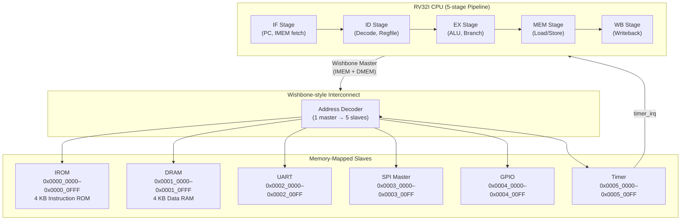

# MiniSoC-32 Architecture

> **Version:** 1.0  
> **Date:** 2026-10-22  
> **Status:** Living document — all RTL agents must follow this spec.

---

## 1. Top-Level Block Diagram



---

## 2. Memory Map

| Region            | Base Address   | End Address    | Size  | Description              |
|-------------------|---------------|----------------|-------|--------------------------|
| Instruction ROM   | `0x0000_0000` | `0x0000_0FFF`  | 4 KB  | Read-only, hex-loaded    |
| Data RAM          | `0x0001_0000` | `0x0001_0FFF`  | 4 KB  | Read/Write               |
| UART              | `0x0002_0000` | `0x0002_00FF`  | 256 B | TX/RX + baud divisor     |
| SPI Master        | `0x0003_0000` | `0x0003_00FF`  | 256 B | Mode 0, clock divider    |
| GPIO              | `0x0004_0000` | `0x0004_00FF`  | 256 B | 8-bit in/out + direction |
| Timer             | `0x0005_0000` | `0x0005_00FF`  | 256 B | 32-bit + compare/IRQ     |
| *Reserved*        | `0x0006_0000` | `0xFFFF_FFFF`  | —     | Unmapped (bus error)     |

**Reset vector:** `0x0000_0000`  
**Stack pointer init:** `0x0001_1000` (top of data RAM)

---

## 3. Pipeline Description

### 3.1 Stage Overview

```
Cycle:   1      2      3      4      5      6
        ┌──────────────────────────────────────┐
Instr1  │  IF  │  ID  │  EX  │ MEM  │  WB  │
Instr2  │      │  IF  │  ID  │  EX  │ MEM  │  WB
Instr3  │      │      │  IF  │  ID  │  EX  │ MEM  WB
        └──────────────────────────────────────┘
```

### 3.2 Hazard Handling

| Hazard Type        | Detection                                      | Resolution                               |
|--------------------|------------------------------------------------|------------------------------------------|
| RAW (register)     | EX/MEM result needed by ID/EX                  | **Data forwarding** (EX→EX, MEM→EX)      |
| Load-use           | MEM-stage load followed immediately by use     | **One-cycle stall** + bubble insertion   |
| Control (branch)   | Branch resolved at EX stage                    | **Flush IF+ID** (2-cycle penalty)        |
| Structural         | Single-port RAM                                | Handled by Harvard-like split bus        |

### 3.3 Pipeline Register Signals (key fields)

**IF/ID Register**

| Field       | Width | Description                  |
|-------------|-------|------------------------------|
| `instr`     | 32    | Raw instruction word         |
| `pc`        | 32    | Current PC                   |
| `pc_plus4`  | 32    | PC + 4                       |

**ID/EX Register**

| Field         | Width | Description                        |
|---------------|-------|------------------------------------|
| `rs1_data`    | 32    | Register source 1 value            |
| `rs2_data`    | 32    | Register source 2 value            |
| `imm`         | 32    | Sign-extended immediate            |
| `rd`          | 5     | Destination register               |
| `rs1`         | 5     | Source register 1 index            |
| `rs2`         | 5     | Source register 2 index            |
| `alu_op`      | 4     | ALU operation code                 |
| `alu_src`     | 1     | ALU B from imm (1) or rs2 (0)      |
| `mem_read`    | 1     | Memory read enable                 |
| `mem_write`   | 1     | Memory write enable                |
| `mem_size`    | 2     | 00=byte, 01=half, 10=word          |
| `reg_write`   | 1     | Register writeback enable          |
| `mem_to_reg`  | 1     | WB source: memory (1) or ALU (0)   |
| `branch`      | 1     | Instruction is branch              |
| `jump`        | 1     | Instruction is JAL/JALR            |
| `pc`          | 32    | PC of this instruction             |

**EX/MEM Register**

| Field         | Width | Description                        |
|---------------|-------|------------------------------------|
| `alu_result`  | 32    | ALU output / branch target         |
| `rs2_data`    | 32    | Store data                         |
| `rd`          | 5     | Destination register               |
| `mem_read`    | 1     | Pass-through                       |
| `mem_write`   | 1     | Pass-through                       |
| `mem_size`    | 2     | Pass-through                       |
| `reg_write`   | 1     | Pass-through                       |
| `mem_to_reg`  | 1     | Pass-through                       |
| `zero`        | 1     | ALU zero flag                      |

**MEM/WB Register**

| Field         | Width | Description                        |
|---------------|-------|------------------------------------|
| `alu_result`  | 32    | Pass-through                       |
| `mem_data`    | 32    | Data read from memory              |
| `rd`          | 5     | Destination register               |
| `reg_write`   | 1     | Pass-through                       |
| `mem_to_reg`  | 1     | Pass-through                       |

---

## 4. CPU Instruction Set (RV32I)

All 37 base integer instructions:

| Category      | Instructions                                        |
|---------------|-----------------------------------------------------|
| ALU R-type    | ADD, SUB, SLL, SLT, SLTU, XOR, SRL, SRA, OR, AND   |
| ALU I-type    | ADDI, SLTI, SLTIU, XORI, ORI, ANDI, SLLI, SRLI, SRAI |
| Load          | LB, LH, LW, LBU, LHU                               |
| Store         | SB, SH, SW                                         |
| Branch        | BEQ, BNE, BLT, BGE, BLTU, BGEU                     |
| Jump          | JAL, JALR                                           |
| Upper imm     | LUI, AUIPC                                          |
| CSR (minimal) | CSRRW, CSRRS (mtvec, mepc, mstatus, mie, mip)      |
| System        | ECALL, EBREAK (treated as NOP for now)              |

---

## 5. Bus Interface (Wishbone B4 simplified)

### 5.1 Master → Slave Signals

| Signal     | Width | Direction        | Description                    |
|------------|-------|------------------|--------------------------------|
| `wb_adr`   | 32    | Master → Slave   | Address                        |
| `wb_dat_o` | 32    | Master → Slave   | Write data                     |
| `wb_we`    | 1     | Master → Slave   | Write enable                   |
| `wb_sel`   | 4     | Master → Slave   | Byte select                    |
| `wb_stb`   | 1     | Master → Slave   | Strobe (slave selected)        |
| `wb_cyc`   | 1     | Master → Slave   | Bus cycle valid                |

### 5.2 Slave → Master Signals

| Signal     | Width | Direction        | Description                    |
|------------|-------|------------------|--------------------------------|
| `wb_dat_i` | 32    | Slave → Master   | Read data                      |
| `wb_ack`   | 1     | Slave → Master   | Transfer acknowledged          |
| `wb_err`   | 1     | Slave → Master   | Bus error (unmapped)           |

### 5.3 Address Decoder Logic

```
if      adr[23:16] == 8'h00  → IROM   (stb_irom)
else if adr[23:16] == 8'h01  → DRAM   (stb_dram)
else if adr[23:16] == 8'h02  → UART   (stb_uart)
else if adr[23:16] == 8'h03  → SPI    (stb_spi)
else if adr[23:16] == 8'h04  → GPIO   (stb_gpio)
else if adr[23:16] == 8'h05  → TIMER  (stb_timer)
else                             → err = 1
```

---

## 6. Peripheral Register Maps

### 6.1 UART (`base = 0x0002_0000`)

| Offset | Name         | Access | Reset      | Description                              |
|--------|--------------|--------|------------|------------------------------------------|
| `0x00` | `UART_TXD`   | W      | —          | Write byte to transmit                   |
| `0x04` | `UART_RXD`   | R      | —          | Read received byte                       |
| `0x08` | `UART_STAT`  | R      | `0x03`     | [1]=TX idle, [0]=RX data ready           |
| `0x0C` | `UART_CTRL`  | R/W    | `0x0000`   | [15:0] baud divisor (clk / (div×16))     |

### 6.2 SPI Master (`base = 0x0003_0000`)

| Offset | Name         | Access | Reset    | Description                              |
|--------|--------------|--------|----------|------------------------------------------|
| `0x00` | `SPI_TXD`    | W      | —        | Byte to shift out (starts transfer)      |
| `0x04` | `SPI_RXD`    | R      | —        | Byte shifted in                          |
| `0x08` | `SPI_STAT`   | R      | `0x01`   | [0]=idle (1=ready, 0=busy)               |
| `0x0C` | `SPI_CTRL`   | R/W    | `0x04`   | [7:0] clock divider (SCK = clk/(2×div)) |
| `0x10` | `SPI_CS`     | R/W    | `0xFF`   | [7:0] chip select (active low)           |

### 6.3 GPIO (`base = 0x0004_0000`)

| Offset | Name         | Access | Reset    | Description                              |
|--------|--------------|--------|----------|------------------------------------------|
| `0x00` | `GPIO_DIR`   | R/W    | `0x00`   | [7:0] direction: 1=output, 0=input       |
| `0x04` | `GPIO_OUT`   | R/W    | `0x00`   | [7:0] output data register               |
| `0x08` | `GPIO_IN`    | R      | —        | [7:0] sampled input pins                 |

### 6.4 Timer (`base = 0x0005_0000`)

| Offset | Name          | Access | Reset        | Description                             |
|--------|---------------|--------|--------------|-----------------------------------------|
| `0x00` | `TIMER_CNT`   | R/W    | `0x0000_0000`| 32-bit free-running counter             |
| `0x04` | `TIMER_CMP`   | R/W    | `0xFFFF_FFFF`| Compare value; IRQ when CNT == CMP      |
| `0x08` | `TIMER_CTRL`  | R/W    | `0x00`       | [0]=enable, [1]=irq_enable, [2]=auto_reload |
| `0x0C` | `TIMER_STAT`  | R/W1C  | `0x00`       | [0]=irq_pending (write 1 to clear)      |

---

## 7. Interrupt Architecture

```
Timer IRQ ──► timer_irq (1-bit) ──► CPU MEM stage
                                        │
                                    mstatus.MIE & mie.MTIE
                                        │
                                    PC ← mtvec
                                    mepc ← PC+4
                                    mstatus.MIE ← 0
```

**CSRs implemented (minimal):**

| CSR Addr | Name       | Description                                |
|----------|------------|--------------------------------------------|
| `0x300`  | `mstatus`  | [3]=MIE (machine interrupt enable)         |
| `0x304`  | `mie`      | [7]=MTIE (machine timer interrupt enable)  |
| `0x305`  | `mtvec`    | Trap vector base address (direct mode)     |
| `0x341`  | `mepc`     | Machine exception PC                       |
| `0x342`  | `mcause`   | Trap cause (written on interrupt)          |
| `0x344`  | `mip`      | [7]=MTIP (machine timer interrupt pending) |

**MRET** restores PC from mepc, sets mstatus.MIE←1.

---

## 8. Clock and Reset

| Signal  | Description                                     |
|---------|-------------------------------------------------|
| `clk`   | Single global clock, all logic positive-edge    |
| `rst_n` | Active-low synchronous reset                    |

---

## 9. Top-Level Port List (`minisoc_top`)

```systemverilog
module minisoc_top #(
    parameter CLOCK_FREQ = 50_000_000,  // Hz
    parameter BAUD_RATE  = 115_200,
    parameter ROM_FILE   = "firmware.hex"
) (
    input  logic        clk,
    input  logic        rst_n,
    // UART
    input  logic        uart_rx,
    output logic        uart_tx,
    // SPI
    output logic        spi_sck,
    output logic        spi_mosi,
    input  logic        spi_miso,
    output logic [7:0]  spi_cs_n,
    // GPIO
    input  logic [7:0]  gpio_in,
    output logic [7:0]  gpio_out,
    output logic [7:0]  gpio_dir,
    // Debug / status
    output logic        timer_irq_out   // routed to pad for debug
);
```

---

## 10. File Structure

```
minisoc/
├── rtl/
│   ├── cpu/
│   │   ├── rv32i_cpu.sv          # Top CPU wrapper
│   │   ├── if_stage.sv           # Instruction fetch
│   │   ├── id_stage.sv           # Decode + register file
│   │   ├── ex_stage.sv           # ALU + branch
│   │   ├── mem_stage.sv          # Memory access
│   │   ├── wb_stage.sv           # Writeback
│   │   ├── hazard_unit.sv        # Stall/flush/forward control
│   │   ├── csr_regfile.sv        # Minimal CSR file
│   │   └── regfile.sv            # 32×32 integer register file
│   ├── bus/
│   │   └── wb_interconnect.sv    # Address decoder + mux
│   ├── mem/
│   │   ├── irom.sv               # Instruction ROM
│   │   └── dram.sv               # Data RAM
│   ├── periph/
│   │   ├── uart.sv               # UART TX/RX
│   │   ├── spi_master.sv         # SPI master mode 0
│   │   ├── gpio.sv               # GPIO controller
│   │   └── timer.sv              # 32-bit timer + IRQ
│   └── top/
│       └── minisoc_top.sv        # SoC top-level
├── tb/
│   ├── unit/
│   │   ├── cpu/  tb_rv32i_cpu.sv, tb_alu.sv, tb_hazard.sv
│   │   ├── bus/  tb_wb_interconnect.sv
│   │   ├── mem/  tb_irom.sv, tb_dram.sv
│   │   └── periph/ tb_uart.sv, tb_spi.sv, tb_gpio.sv, tb_timer.sv
│   └── system/
│       └── tb_minisoc_top.sv     # Full SoC system test
├── fw/
│   ├── src/
│   │   ├── startup.S             # Reset vector, stack init
│   │   └── main.c                # Firmware entry point
│   ├── include/
│   │   └── minisoc.h             # Memory-mapped register defines
│   ├── link.ld                   # Linker script
│   └── Makefile
├── syn/
│   ├── synth.ys                  # Yosys synthesis script
│   └── reports/
├── pd/
│   └── config.json               # OpenLane2 config
├── docs/
│   ├── ARCHITECTURE.md           # This file
│   └── PROGRESS.md
└── scripts/
    ├── run_all.sh
    └── regress.sh
```

---

## 11. Design Constraints

| Parameter          | Value         |
|--------------------|---------------|
| Target technology  | SkyWater sky130 |
| Core clock         | 50 MHz (20 ns) |
| Target cell area   | < 0.5 mm²    |
| Pipeline stages    | 5             |
| Data width         | 32-bit        |
| Address space      | 32-bit        |
| Bus protocol       | Wishbone B4 (single transfer) |
| Synthesis tool     | Yosys 0.52    |
| P&R tool           | OpenLane 2.3.10 |

---

*All RTL agents must keep this document as the single source of truth for addresses, signal names, port lists, and register definitions.*
